<p align="center">
  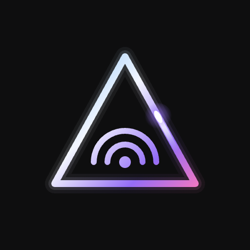
</p>

<h1 align="center">JellyCast</h1>

<p align="center">
  <b>A Jellyfin client for Android TV that stays smooth on a Chromecast with 2 GB of RAM.</b><br>
  From the couch to the movie, fast. No stutter, no missed key presses, no jumping focus.
</p>

<p align="center">
  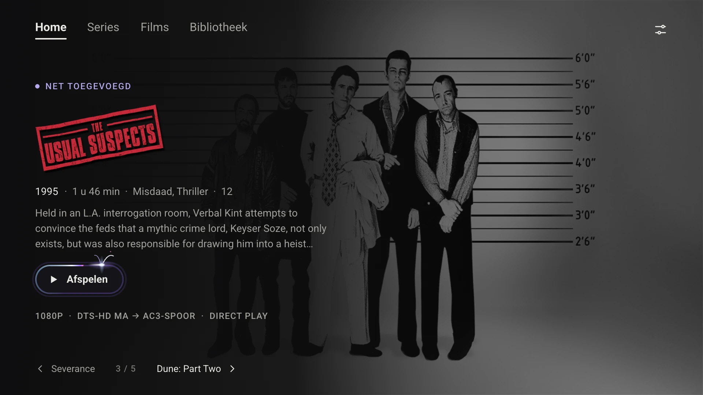
</p>

---

## Why this app?

I run a [Jellyfin](https://jellyfin.org) server with my own movies and series, and there is a **Chromecast with Google TV 4K** (2020) under my TV. It is a modest device: a small GPU, four low-power cores and 2 GB of memory. The existing apps all fall just short on it:

- **Plex** freezes, misses key presses or handles them in the wrong order, and the focus jumps around.
- **Jellyfin (official)** works, but isn't pretty.
- **Wholphin** is pretty, but too heavy for this device.

JellyCast fills that gap. It started as a technical question: *can a Jellyfin client run smoothly, without stuttering, on this Chromecast?* While building it, it also became a question about the interface: *what do I actually need to start watching a movie or a series?*

The answer: not much. The server already holds only what I chose to put there. I don't need to browse endlessly; I want to start watching quickly.

## What it does

- **Browse** movies and series, grouped into *Continue watching*, *New* and one row per genre.
- **Play** everything on the server, using **direct play** wherever possible: no transcoding on the server, so full quality and a fast first frame. 4K, HDR10 and Dolby Vision where the device supports them.
- **Pick up** where you left off, and continue straight to the next episode.
- **Search and sort** in the Library, for when you're looking for something specific.
- **Sign in with your phone** via Quick Connect, or with a password.
- Available in **English, Dutch, French and Spanish** (see [translating](docs/translating.md)).

## Movies and series: two ways of choosing

Before you turn on the TV, you usually already know whether you want a movie or an episode. That's why they are two separate sections, each with its own layout.

### Series: where was I?

You watch series in parts, so the main question is *where did I leave off?* There's a well-known pattern for that, and JellyCast follows it: **Continue watching** at the top, with the next episode of each series and a progress bar. Below that **New episodes**, **Not started yet** and the genres.

<p align="center">
  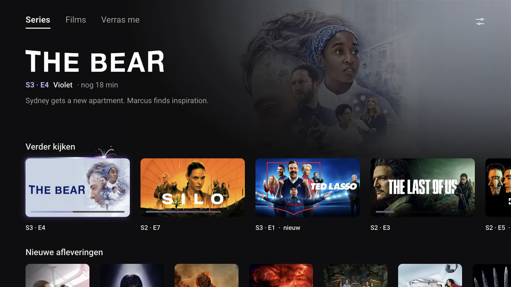
</p>

A series has a single page with everything on it: the **Continue · S3 · E4** button at the top, and every season as a row below. No separate screens for seasons or episodes.

<p align="center">
  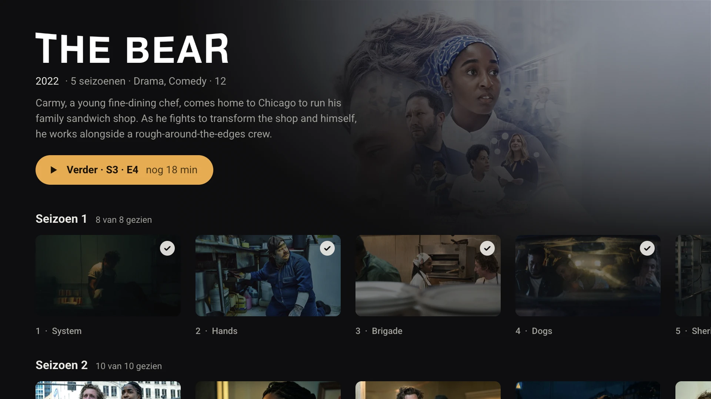
</p>

### Movies: one at a time

You pick a movie on feeling. A wall of a hundred posters doesn't help with that: you keep scrolling and never choose. So JellyCast shows **one movie per screen**, large, with a backdrop, logo, short description and a single button: **Watch**. ← and → take you to the next movie, ↓ to the next shelf (Continue watching, New, Action, Drama…).

Every movie gets enough room for you to decide, and watching is always one press of OK away.

<p align="center">
  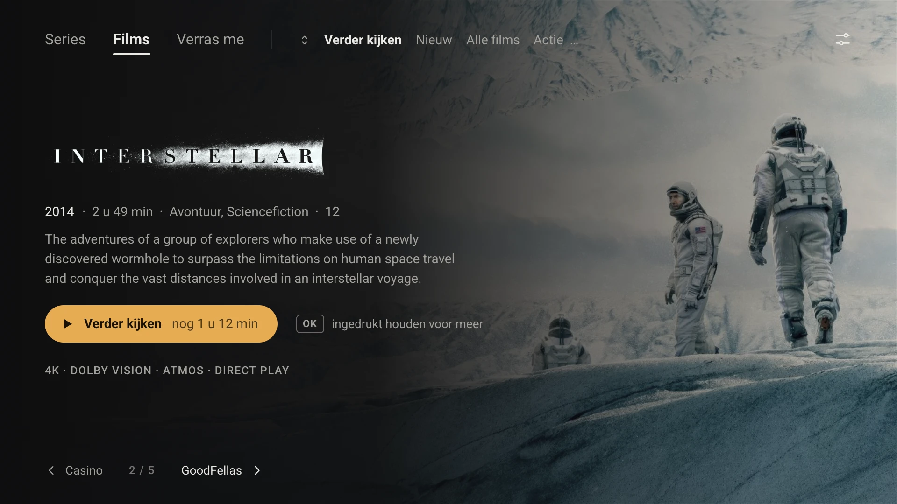
</p>

Prefer something more visual to browse? In Settings you can switch to the **DVD shelf**: every movie as a spine on a shelf, with the selected one folded open.

<p align="center">
  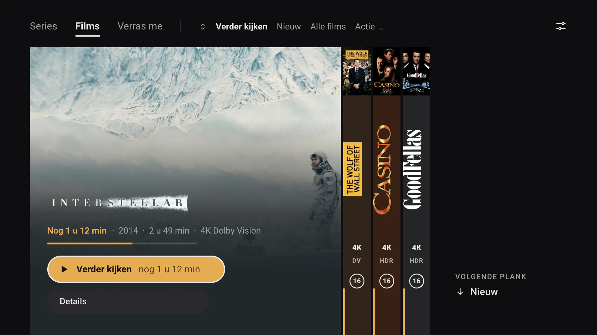
</p>

## Why the design is the way it is

Every decision follows one order of priority:

> **Works well > responds instantly > looks good.**

Better slightly less pretty and smooth than very pretty and slow. A lot follows from that:

- **Every key press has an immediate effect**, also when you hold it down. Key presses are never lost and are handled in order.
- **The focus never jumps on its own.** Data that arrives later may not move the focus.
- **A click goes through right away.** The next screen appears immediately; anything still loading is a calm skeleton in the right sizes, so nothing shifts when the content arrives.
- **No heavy effects.** No blur, no shadow per card, no trailers that start on their own, no parallax. On this GPU they cost frames, and an effect that stutters is removed.
- **Images at exactly the right size.** Every poster and backdrop is requested at the size it's shown at, never larger.
- **Little on screen at once.** A few rows, one backdrop, no titles under posters (the poster already says it).

The one real piece of decoration is the **neon border** around the selected item: a trail of light that runs around the edge while the focus rests. One cheap drawing path, only on the focused element.

Measured on the Chromecast (release build): cold start under 1 s, about 110 MB of memory after five minutes of browsing.

## Using the remote

Everything works with **↑ ↓ ← →**, **OK** and **Back**. The design is minimal, but it follows a few fixed rules, so after a while you know where you'll end up without looking:

- **Entering a row always puts you on the first item.** Season 3, episode 5 is therefore always 3× ↓ and 4× →.
- **Back returns you to where you came from**, on the same item.
- **Back on an overview** goes to the section bar at the top; from the bar, Back goes to Home, and on Home pressing Back twice closes the app.
- **Holding OK** opens more options (from the start, mark as watched). There is always a hint next to the button.

The full guide, screen by screen, is in **[Using the remote](docs/navigation.md)**.

## Screens

<table>
  <tr>
    <td width="50%">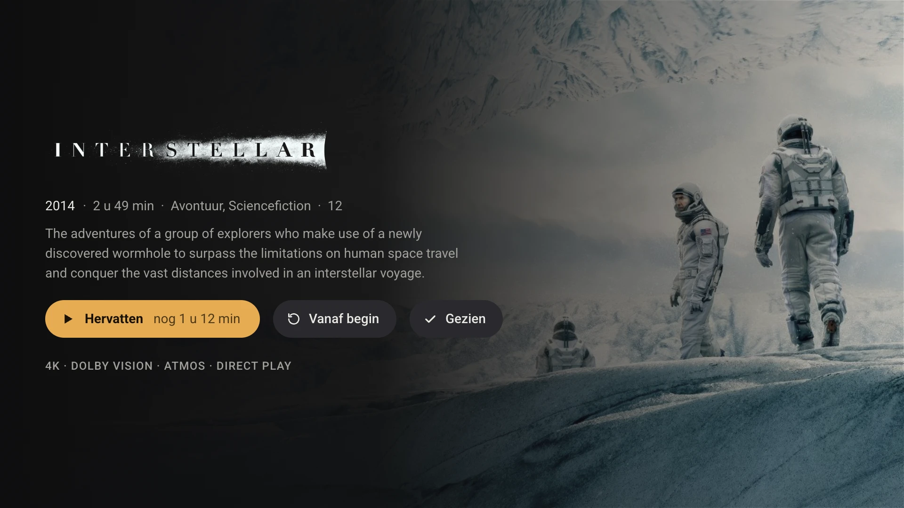<br><b>Movie detail</b>: the full description and a technical line, so you can see in advance whether it will direct play.</td>
    <td width="50%">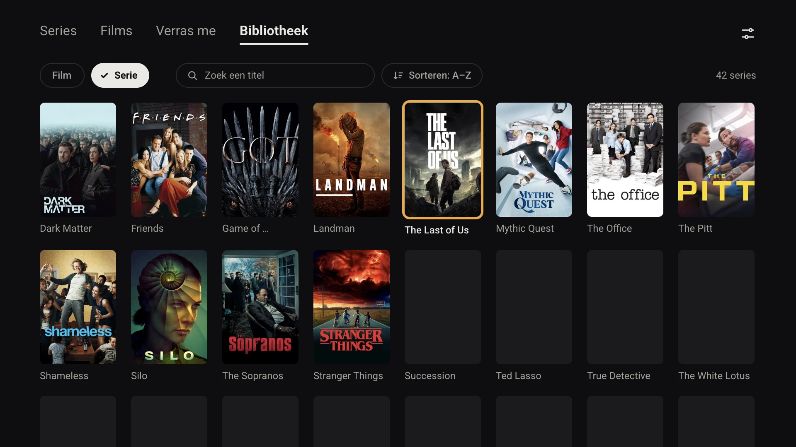<br><b>Library</b>: everything A–Z, search by title and sort.</td>
  </tr>
  <tr>
    <td width="50%">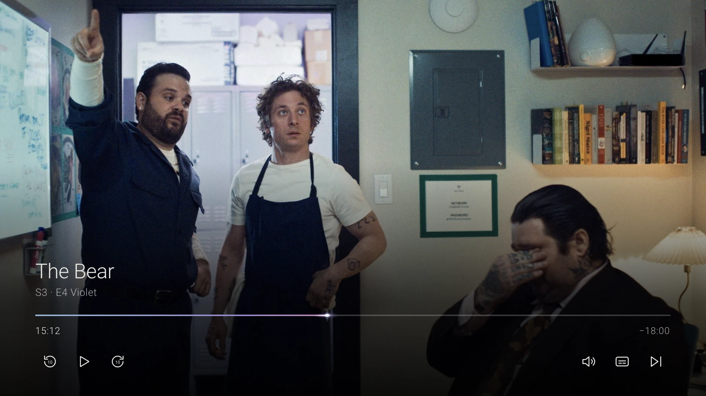<br><b>Player</b>: thin type, no panels, fades out after 4 s.</td>
    <td width="50%">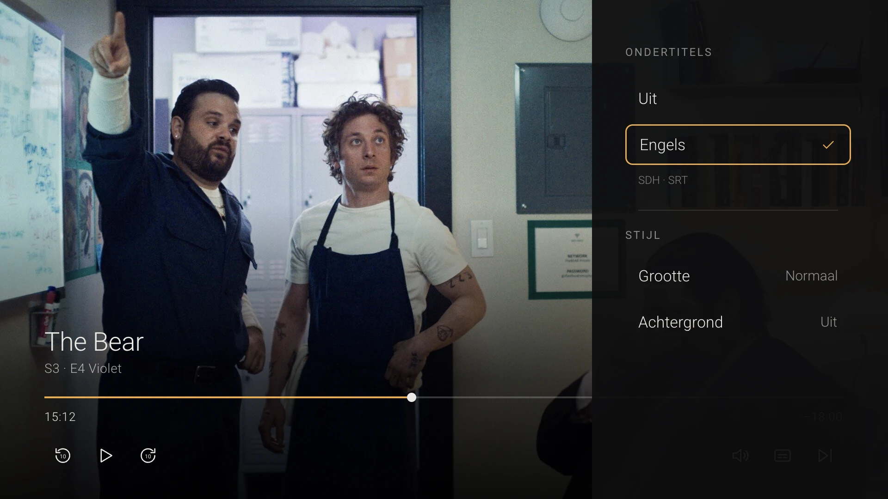<br><b>Audio and subtitles</b>: a panel on the right, with the technical details.</td>
  </tr>
  <tr>
    <td width="50%">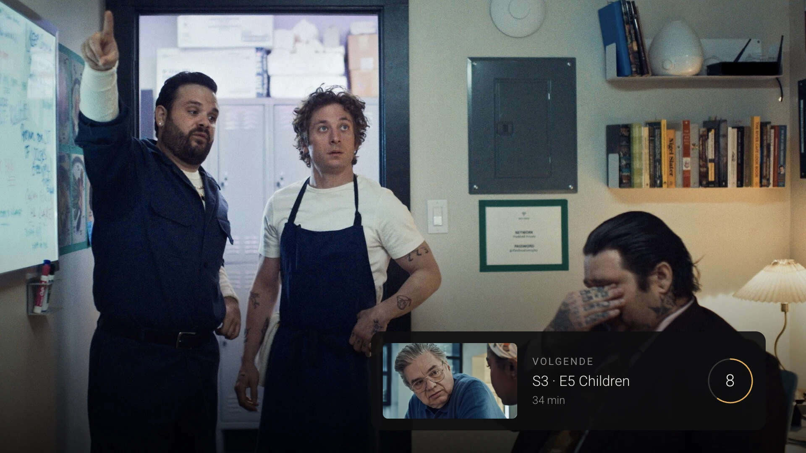<br><b>Next episode</b>: counts down during the credits.</td>
    <td width="50%">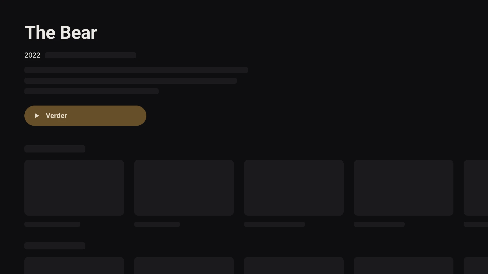<br><b>Skeleton</b>: what a screen looks like while it loads.</td>
  </tr>
  <tr>
    <td width="50%">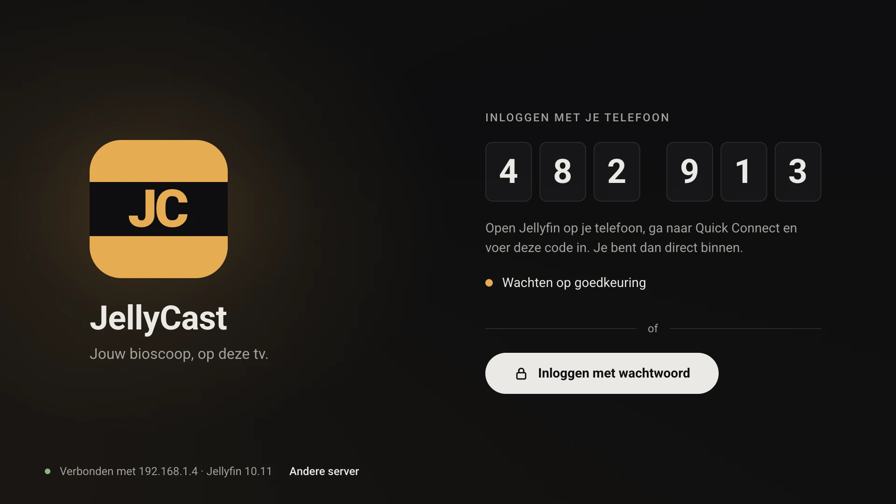<br><b>Sign in</b> with a code on your phone.</td>
    <td width="50%">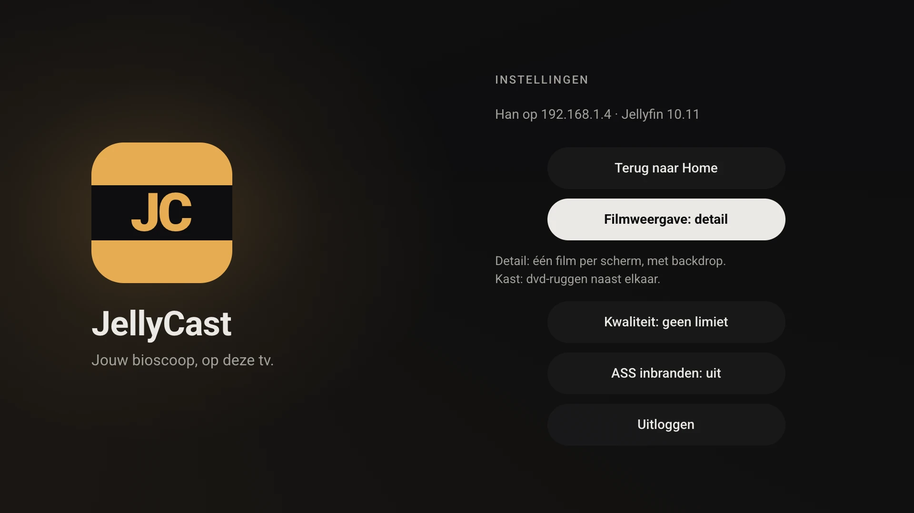<br><b>Settings</b>: language, movie view, quality.</td>
  </tr>
</table>

The images come from the design in [Paper](https://paper.design) and show the Dutch interface. The app differs in the details: the design sets the structure, the app has the final word.

## Installing

JellyCast is not in the Play Store. You build it yourself and install it on your TV with `adb`.

You'll need: a Jellyfin server, an Android TV device running Android 14 or later (built and tested on the Chromecast with Google TV 4K), and Android Studio (which brings the Android SDK and a JDK).

1. On the TV, enable the developer options and (wireless) debugging. Step by step: [docs/setup.md](docs/setup.md#preparing-the-chromecast-for-development).
2. Connect and install:

   ```bash
   adb connect <your-tv-ip>:5555
   ./gradlew :tv:assembleRelease
   adb install -r tv/build/outputs/apk/release/tv-release.apk
   adb shell cmd package compile -m speed -f nl.jellycast.tv
   ```

   The last step compiles the app ahead of time. Without it, the app runs in the interpreter for a while and feels slower than it is.
3. Open JellyCast from the Google TV home screen, enter your server address and sign in.

Without `keystore.properties`, `assembleRelease` builds an unsigned APK. How to set up signing and what to test where is in [docs/setup.md](docs/setup.md) and [docs/testing-emulator-and-device.md](docs/testing-emulator-and-device.md).

## How it's built

Kotlin, Jetpack Compose with [Compose for TV](https://developer.android.com/training/tv/playback/compose), Media3/ExoPlayer, the [Jellyfin Kotlin SDK](https://github.com/jellyfin/jellyfin-sdk-kotlin), Coil and Koin. Three Gradle modules: `:core` (models, Jellyfin access, repositories and the playback engine), `:tv` (this app) and `:mobile`, a simpler phone and tablet app (Material 3) on the same core. Each app is organised by feature. Every library is listed with an explanation in [docs/dependencies.md](docs/dependencies.md).

The project documentation:

| Document | About |
|---|---|
| [docs/setup.md](docs/setup.md) | Tooling, preparing the TV, signing and installing |
| [NOTES.md](NOTES.md) | Status, decisions, measurements on the device, codec findings |
| [.claude/rules/](.claude/rules/) | The rules: product principles, design, architecture, TV UX, playback |
| [docs/research/](docs/research/) | Research, sources and the comparison with the official client |

The project was largely built with [Claude Code](https://claude.com/claude-code). That makes the rules in `.claude/rules/` the best place to see *why* things are the way they are.

## Contributing or forking

JellyCast was made for my own TV and my own way of watching. That's exactly what makes it a good starting point for yours.

- **Ideas and improvements are welcome.** Open an issue or a pull request; see [CONTRIBUTING.md](CONTRIBUTING.md). If it fits "smooth comes before pretty", I'm happy to take a look.
- **Forking is fine too.** Make your own version for your own Chromecast, with your own choices. A small mention of where it came from is appreciated.

## Content

JellyCast is a client for your own Jellyfin server. It does not provide, host or index any content. You are responsible for the content on your server and for having the rights to play it.

## License

[MIT](LICENSE). Open source: do whatever you want with it, as long as the copyright notice and license stay with the code.

The app built from it includes Jellyfin's FFmpeg audio decoder, which is GPL-3.0; whoever shares the APK must also share its source code. Every library and its license is in [THIRD-PARTY-NOTICES.md](THIRD-PARTY-NOTICES.md).

JellyCast is not an official Jellyfin project. The movie images in the design pictures are for illustration only and remain the property of their creators.
