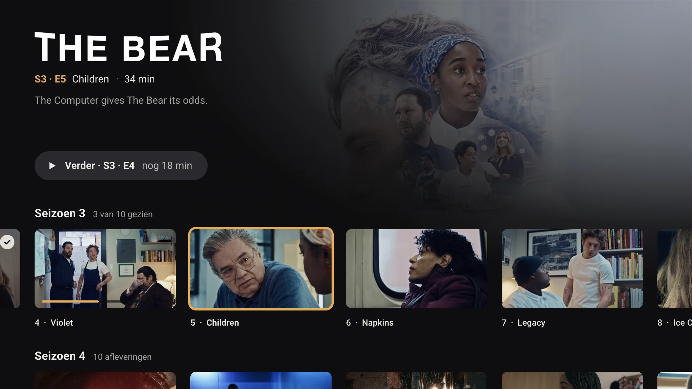
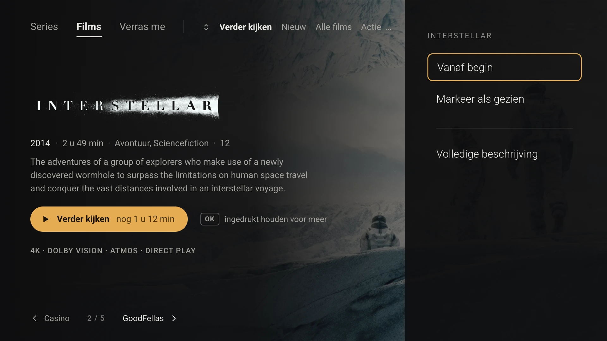

# Using the remote

JellyCast only uses the arrows (↑ ↓ ← →), **OK** and **Back**. There are no hidden menus behind the menu button. This page explains how to get everywhere, and why it works this way.

## The idea: count instead of search

Every screen is a grid: rows stacked vertically, with items side by side. Every spot is therefore "so many times ↓, so many times →" from the screen's starting point. After a few times you know where you'll end up without looking.

Two rules make that possible:

1. **Entering a row with ↑ or ↓ always puts you on the first item.** A row doesn't remember where you were last time. Otherwise the number of presses would depend on what you did before, and you could no longer count.
2. **No wrap-around.** → on the last item or ← on the first item does nothing. You never jump unexpectedly to the start or to another element.

One exception: when you press **Back** to leave a detail screen or the player, you land exactly on the item you came from.

> Example: on the series page, season 3, episode 5 is always **3× ↓ and 4× →** from the Continue button.
>
> 

## The section bar

At the top is the bar with **Home · Series · Movies · Library**, and the gear for Settings on the right.

- On the bar, **← / →** switches section immediately, without OK.
- **↓** goes to the section's starting point.
- **↑** from the first row (or from Play) takes you back to the bar.

## Back

| Where you are | What Back does |
|---|---|
| A panel or menu is open | Closes the panel |
| Anywhere in Home, Series, Movies or Library | Goes to the section bar; the section quietly resets to its start |
| On the section bar, not on Home | Goes to the Home tab |
| On the Home tab | Shows "Press Back again to exit"; Back again within 2 s closes the app |
| On a detail screen, not on the starting point | Goes to the starting point (the Play or Continue button) |
| On a detail screen, on the starting point | Back to the previous screen, on the item you came from |
| In the player, overlay visible | Hides the overlay |
| In the player, no overlay | Stops playback |

## Starting point per screen

| Screen | Starting point (has focus when you arrive) |
|---|---|
| Home | **Play** / **Resume** |
| Series | First card of the first row |
| Movies | First movie of the first shelf |
| Library | The Movie / Series choice; **↓** = first tile |
| Series page | **Continue · S3 · E4** |
| Movie detail | **Play** / **Resume** |
| Player | The timeline |

## Holding OK

A short press of OK does the main action (play). **Holding OK** opens a panel with more options, such as *From the start* or *Mark as watched*. Wherever that's possible, there is always a hint next to the button: *"[OK] hold for more"*. The short action only starts when you release the button, so a long press never starts playback by accident.

## Holding an arrow to browse

Hold an arrow down and the focus moves along smoothly. Along the way the app doesn't load any large images: in the movie view you see a plain background while browsing, and the backdrop appears once you rest for about 0.3 s. That keeps browsing fluid, even with hundreds of movies.

## Per screen

### Home

Up to five suggestions, one at a time, with what you most likely want to watch now first: something you stopped halfway in the last few days, a new episode of a series you keep up with, the next episode of a series you're watching, then movies added in the last 30 days. A small label above the title says why it's there (*Continue watching*, *New episode*, …).

- **OK** plays the suggestion (or resumes it).
- **← / →** browses to the previous or next suggestion; bottom left shows *‹ previous · 2 / 5 · next ›*.
- **Back** goes to the section bar and the suggestion stack quietly returns to suggestion 1.

Stopping in the end credits counts as watched, so a finished episode doesn't keep coming back.

### Series

- **↓ / ↑** switches rows: Continue watching → New episodes → Not started yet → genres (A–Z).
- **← / →** moves through the cards in a row.
- **OK** on a card in *Continue watching* plays that episode directly.
- **Holding OK** on a card in *Continue watching* opens the options: *Mark as watched*, *Mark as unwatched* (only when the episode is in progress) and *Go to series*, which opens the series page with the focus on that episode.
- **OK** on a series poster opens the series page.

### Series page

- Starts on **Continue**: OK plays the episode where you left off.
- **→** from Continue: *Mark S3 · E4 as watched* and *Mark series as watched*.
- **↓** goes to season 1, episode 1; each further ↓ is the next season.
- At the end of each season row: *Mark season as watched*.

### Movies (detail view, the default)

- **← / →** browses movie by movie. Bottom left you see "‹ previous · 2 / 5 · next ›".
- **↓ / ↑** switches shelves: Continue watching → New → genres. The top shows which shelf you're on.
- **OK** plays; **holding OK** opens the options.

### Movies (bookcase, selectable in Settings)

- **← / →** folds open the next or previous spine.
- The open movie has two buttons stacked: **↓** goes from *Watch* to *Details*, another **↓** to the next shelf.

### Library

- At the top: **Movie / Series**, the search field and **Sort**. OK on Sort cycles A–Z → Recently added → Year → Rating.
- OK on the search field opens the keyboard; the grid filters as you type.
- The grid has 8 columns; **↑ / ↓** stays in the same column.

### Player

- **← / →** skips 10 s; holding speeds up to 30 s steps.
- **OK** pauses or resumes. Right after skipping (within 3 s), **OK** confirms the jump and plays, so "skip, then OK" works as in Netflix and the official Jellyfin app.
- **↓** goes to the icons: audio, subtitles, info and (for series) next episode.
- At the end of an episode, a jump pill in the bottom right counts down to the next one. **OK** = continue now, **Back** = dismiss the pill.
